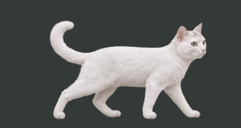
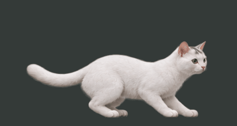
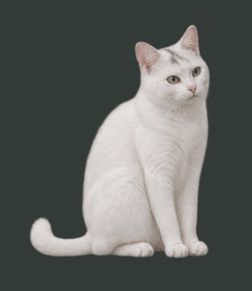
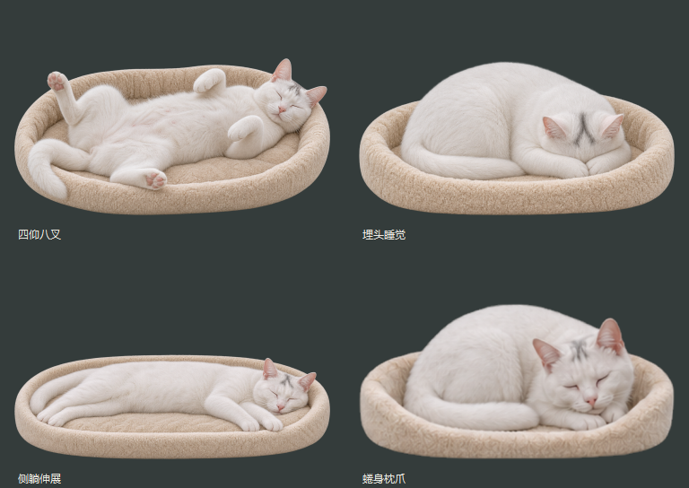

# TUANZI · 团子桌面宠物

一只会在桌面闲逛、追蝴蝶、舔爪洗脸，也会钻进猫窝睡觉的写实白猫。

团子的形象来自真实猫咪：白色短毛、绿眼睛、粉鼻子、头顶浅灰色分叉印记，以及偏长、偏大的身体。用透明窗口陪在桌面上，日常运行无需联网。

<p align="center">
  
</p>

[下载 v1.0.0](https://github.com/zhouluna/TUANZI/releases/tag/v1.0.0) · [详细部署说明](DEPLOY.md) · [云端构建](https://github.com/zhouluna/TUANZI/actions/workflows/build-desktop.yml)

## 团子会做什么

- **自然闲逛**：在当前屏幕的可用桌面范围内自由走动，偶尔小跑；步频随移动速度变化，支持关闭漫游。
- **看向鼠标**：清醒时眼珠平滑跟随鼠标，不设置周期性眨眼。
- **随机活动**：撒娇、吃东西、招手、打呼噜、玩猫球、舔爪洗脸和舔毛，按权重随机衔接，减少重复。
- **捉蝴蝶**：发现、追逐、扑捉、停步观察，再目送蝴蝶飞走；可以自动偶遇或手动触发。
- **猫窝睡觉**：四仰八叉、埋头、侧躺伸展、蜷身枕爪四种睡姿，配合连续胸腹呼吸。自动小睡约 45～90 秒，也可让它一直休息。
- **桌面陪伴**：拖动摆放、三档大小、窗口置顶、暂停、托盘找回；自动记住位置和常用开关。

## 动作预览

以下 GIF 展示动作素材循环；实际程序还会移动宠物窗口、跟随鼠标并随机切换活动。

| 走路 | 小跑 |
| --- | --- |
|  |  |

| 舔爪洗脸 | 猫窝睡姿 |
| --- | --- |
|  |  |

## 下载与运行

### Windows 10 / 11 · 64 位

1. 在 [Releases](https://github.com/zhouluna/TUANZI/releases/tag/v1.0.0) 下载 **`Tuanzi-1.0.0-windows-x64.zip`**，完整解压。
2. 双击 `Tuanzi.exe` 或 `一键启动.cmd`，无需安装 Python。
3. 需要桌面入口时，双击 `创建桌面快捷方式.cmd`。

移动程序时请保留整个解压文件夹。重复启动会找回现有团子。

### macOS 14+ · Apple Silicon / Intel

1. 在 [Releases](https://github.com/zhouluna/TUANZI/releases/tag/v1.0.0) 下载 **`Tuanzi-1.0.0-macos-one-click.zip`**，完整解压。
2. 打开 `Tuanzi-Mac-Setup`，双击 `deploy-macos.command`。
3. 首次部署会联网准备环境、在 Mac 本机构建并安装 `~/Applications/Tuanzi.app`，之后双击应用即可离线运行。

首次无需预装 Python、Homebrew 或完整 Xcode。若缺少 Apple 命令行工具，脚本会打开官方安装界面，完成后继续。首次打开下载的未签名脚本时，可使用系统正常的“右键 → 打开”流程。

**当前 Mac 下载项是自动构建的部署源码包，尚未在真实 Mac 上完成运行验证；Windows 免安装包已完成本机启动验证。** 详细要求及数据目录见 [DEPLOY.md](DEPLOY.md)。

## 怎么和团子互动

| 操作 | 效果 |
| --- | --- |
| 单击团子 | 撒娇和文字气泡 |
| 按住左键拖动 | 调整桌面位置 |
| 双击团子 | 休息 / 唤醒 |
| 移动鼠标 | 清醒时眼珠跟随 |
| 右键 → 动作 | 选择走路、小跑、捉蝴蝶、梳理、睡觉等动作 |
| 右键 → 动作 → 选择睡姿 | 指定喜欢的睡姿 |
| 右键 → 自主活动 / 自由漫游 / 偶遇蝴蝶 | 分别控制随机活动、桌面移动和蝴蝶场景 |
| 右键菜单 | 调整大小、置顶、暂停、隐藏、找回或退出 |
| 单击系统托盘图标 | 找回团子 |

## 从源码运行

使用 Python 3.10+；发布构建使用 Python 3.14。运行依赖为固定版本的 `PySide6-Essentials`。

```bash
git clone https://github.com/zhouluna/TUANZI.git
cd TUANZI
```

Windows：首次双击 `setup-pet.cmd` 安装依赖并启动；以后双击 `start-pet.cmd`。macOS：运行 `./deploy-macos.command` 完成部署。

也可在自己的虚拟环境中运行：

```bash
python -m pip install -r requirements.txt
python -m desktop_pet
```

向正在运行的团子发送指令：

```bash
python -m desktop_pet --status
python -m desktop_pet --action butterfly
python -m desktop_pet --action groom
python -m desktop_pet --action bed-belly
python -m desktop_pet --quit
```

## 打包与项目结构

- Windows 本机打包：双击 `build-windows.cmd`。
- macOS 本机打包：运行 `./deploy-macos.command`，或在已配置构建环境中运行 `python scripts/build_release.py`。
- GitHub 一键构建：进入 **Actions → Build desktop packages → Run workflow**，分别构建 Windows x64、Mac ARM64、Mac x64；完成后从该次运行下载 Artifacts。
- 检查行为：`python -m unittest discover -s tests -v`。
- 检查原生构建产物：`python scripts/verify_release.py`。

```text
desktop_pet/          宠物窗口、随机活动、眼球、蝴蝶与睡眠
assets/               已确认形象和程序实际使用的动作素材
docs/images/          README 动作预览
packaging/            原生打包配置、依赖和第三方许可文本
scripts/              发布构建与产物验证
tests/                行为及打包回归检查
.github/workflows/    Windows / macOS 手动构建工作流
DEPLOY.md             完整部署说明
```

源码运行的数据保存在 `.local/`；打包版使用系统用户数据目录 `TuanziPet/`。虚拟环境、个人设置、日志和构建目录不提交到仓库。发布包附带 SHA-256 校验文件和运行资源自检。

## 当前边界

团子是 **二维写实素材与局部形变驱动**的桌面宠物；部分动作使用 AI 生成帧和补帧，尚无三维骨骼，动作接缝及遮挡处可能有轻微形变。打呼噜目前只有视觉动作，未加入音频。四季服装仍处于设计预览阶段，未加入当前版本。

第三方组件的许可文本随发布包提供，相关文本也位于 [packaging/licenses](packaging/licenses)。本项目尚未声明自身代码和形象素材的开源许可证。
